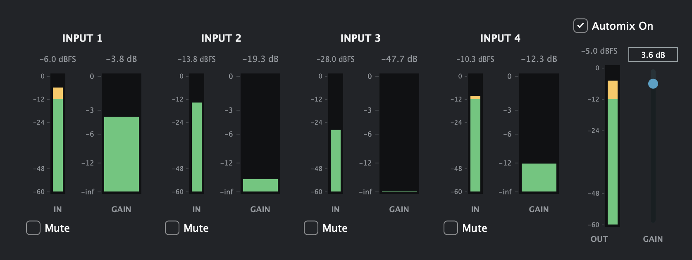

# DuganAutomixer

A four-microphone gain-sharing automixer built with C++17 and JUCE. It runs as a macOS Audio Unit, VST3, or standalone application.

I built this project to learn how an automixer behaves in practice and to work through the real-time details around smoothing, metering, UI communication, and plugin state. When several microphones are open, the plugin gives more gain to the active speaker and turns down quieter inputs. The result is a mono mix sent to both output channels.



## Features

- Four discrete microphone inputs
- Dugan-style gain sharing based on relative signal power
- Per-channel mute, editable names, and input/gain meters
- Automix bypass and -24 to +6 dB output trim
- Smoothed gain, mute, bypass, and output-level changes
- Session recall for names, mute states, automix state, and output gain

## How it works

Each input is squared and passed through an attack/release envelope follower. The gain for a channel is its share of the total measured power:

```text
P_i[n] = alpha * P_i[n-1] + (1 - alpha) * x_i[n]^2

gain_i[n] = (P_i[n] + epsilon) / (sum(P_j[n]) + 4 * epsilon)
```

With four equally powered inputs, each settles near a gain of `0.25` (`-12 dB`). When one input dominates, its gain approaches `1.0` while the others are attenuated.

The envelope uses a 10 ms attack and 100 ms release, followed by 30 ms gain smoothing. Muted channels are removed from the power calculation so a loud muted microphone cannot suppress the remaining inputs.

## Real-time design

The part I found most interesting was keeping the audio callback separate from the interface:

- DSP state uses fixed-size arrays, and `processBlock` does not explicitly allocate memory, access files, or acquire a mutex.
- The audio thread publishes meter values through atomics. The UI reads them at 30 Hz and clears stored peaks after each read.
- Input names are protected separately because the audio callback never needs to read them.
- Mute and bypass changes are faded to avoid abrupt discontinuities.
- Plugin state is serialized as XML for host-session recall.

## Building

You will need macOS 12 or later, Xcode, and JUCE/Projucer. JUCE is not included in this repository.

1. Open [`DuganAutomixer.jucer`](DuganAutomixer.jucer) in Projucer. The checked-in project was generated with Projucer 9.0.2.
2. Point the global JUCE modules path to your local `JUCE/modules` directory.
3. Save the project to regenerate the Xcode files with your local paths.
4. Open `Builds/MacOSX/DuganAutomixer.xcodeproj`.
5. Build the AU, VST3, or Standalone Plugin scheme.

The plugin requires a host configuration with four discrete inputs and two outputs. Both outputs carry the same mono mix.

## Current limitations

- The channel layout is fixed at four inputs and two identical outputs.
- Controls are saved with the session but are not exposed as host-automation parameters.
- Only a macOS exporter is currently configured.
- There is no output limiter, so bypassing automix may require additional headroom.
- Automated DSP tests, callback benchmarks, and a host-compatibility matrix are still to be added.

My next step is to add signal-based regression tests across sample rates and buffer sizes, then measure worst-case callback time rather than making assumptions about performance.

## Code guide

- [`Source/PluginProcessor.cpp`](Source/PluginProcessor.cpp): DSP, metering, bus layout, and state recall
- [`Source/PluginProcessor.h`](Source/PluginProcessor.h): processor state and audio/UI communication
- [`Source/PluginEditor.cpp`](Source/PluginEditor.cpp): controls, meters, and interface layout
